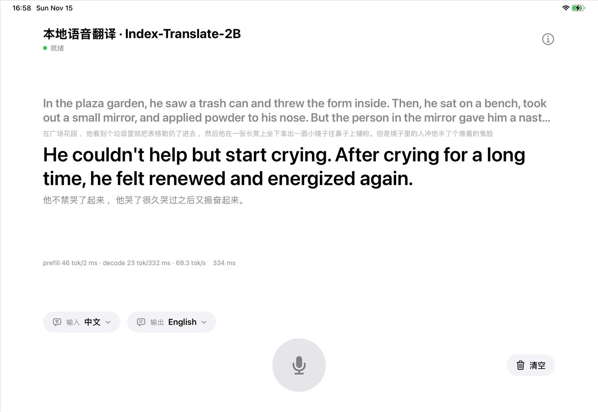
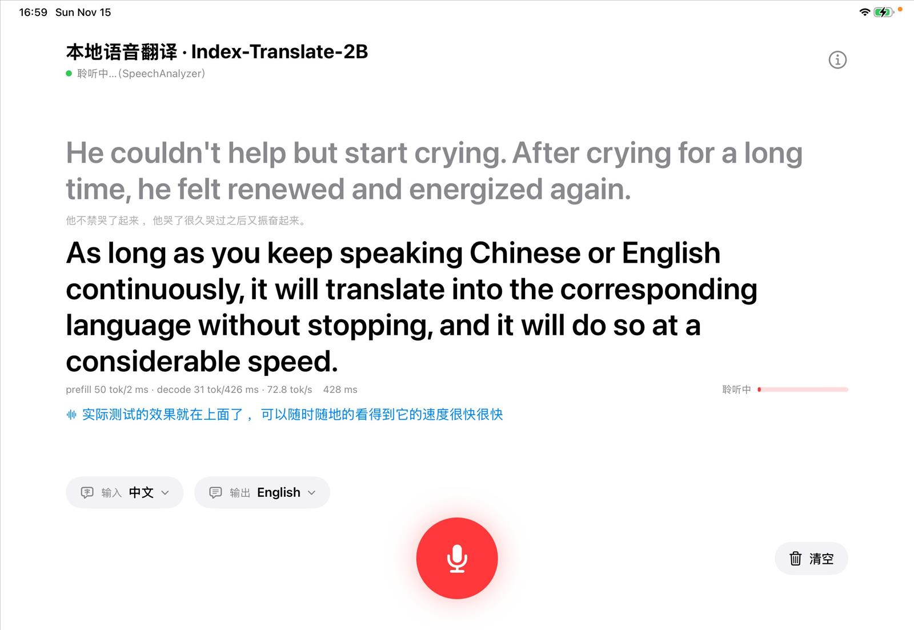

[中文](README.md) | [English](README.en.md)

# index-translate

**An offline speech translation app for iPad: say a sentence, get the translation on screen.**


 

## What it is

A local speech translator for **iPadOS 26**. Microphone → Apple `SpeechAnalyzer` (on-device streaming transcription) → `Index-Translate-2B` (GGUF, llama.cpp + Metal) → translation.

Audio and text never leave the device. No cloud service, and no Mac needed to build or install: builds run on GitHub Actions, and the app is sideloaded from Windows with Sideloadly.

The model is [IndexTeam / bilibili's Index-Translate-2B](https://huggingface.co/IndexTeam/Index-Translate-2B) (Apache-2.0). **This repository does not distribute model weights.** The app fetches the official GGUF only when you tap download, or reads a `.gguf` file you put on the device yourself.

## Features

| | Feature | Detail |
|---|---|---|
| 🎙 | On-device streaming transcription | `SpeechAnalyzer` + `SpeechTranscriber` (iPadOS 26); the system ships 31 locales, this app uses Chinese / English |
| 🌐 | Input: any of the 7 languages, or Auto | Auto uses the Chinese recognizer by default; the dual-recognizer mode is an experimental switch in the ⓘ panel |
| 🗣 | Output: 7 languages | Chinese, English, Japanese, Korean, French, German, Spanish |
| 📝 | English terms kept verbatim | Identity glossary hard constraint, so `dining hall` / `deadline` / `API` are not paraphrased |
| 📜 | Continuous subtitles | Previous sentence (grey) + current sentence (black), plus a live "listening" line |
| 📊 | Input level meter | Log scale with peak auto-calibration |
| 🔇 | Punctuation-only segments dropped | No wasted inference on a lone "。" |
| 📦 | Multiple models side by side | Q4_K_M and Q8_0 can coexist; pick one in the ⓘ panel. Largest file wins until you choose |
| ⚡ | Full Metal offload | 26/26 layers on GPU, prefill 44,000–48,000 tok/s on iPad Pro M5 |
| 🔒 | Fully offline | Only the model download needs network |
| 🧾 | Copy diagnostics | One tap copies device, engine, model, last timings and log tail |

## Quick start

> Full walkthrough (with troubleshooting): **[docs/INSTALL-IPAD.md](docs/INSTALL-IPAD.md)**.

1. **Get the ipa** from [Releases](https://github.com/Baizhi-Angelica/IndexTranslate_iPadM5/releases) — the latest `index-translate-v1.0.0-unsigned.ipa`. It is **unsigned** — you re-sign it with your own Apple ID in the next step.
2. **Install**: on Windows install [iTunes](https://www.apple.com/itunes/download/win64) (or [iCloud for Windows](https://support.apple.com/downloads)) from Apple for the device drivers, then [Sideloadly](https://sideloadly.io/). Connect the iPad, enter your Apple ID, drop the ipa in, press Start. Enable **Settings → Privacy & Security → Developer Mode** on the iPad once and reboot.
3. **Add a model**: either tap "Download Q4_K_M / Q8_0" inside the app (**ModelScope / China CDN first**, falls back to `hf-mirror.com` then `huggingface.co`), or download it manually from the [ModelScope model page](https://www.modelscope.cn/models/IndexTeam/Index-Translate-2B-GGUF) in Safari and move the `.gguf` into **Files → On My iPad → index-translate**.
4. **Grant microphone access and talk**: pick input and output language, tap the microphone, say one sentence.

> Free Apple ID signatures expire after **7 days**. Re-sign with Sideloadly (one Start click); your model and settings survive.

## Choosing a model

| Quant | File | Size | Single-sentence latency (iPad Pro M5) | Recommendation |
|---|---|---:|---:|---|
| **Q4_K_M** | `Index-Translate-2B.Q4_K_M.gguf` | 1,251.4 MB | 166–430 ms | Smaller; best for older devices |
| **Q8_0** | `Index-Translate-2B.Q8_0.gguf` | 1,980.5 MB | About the same as Q4 in practice | **Recommended on M-series iPads** (better quality) |

Download sources (the app tries them in this order; you can also grab the file yourself):

| Source | Notes | Direct link |
|---|---|---|
| **ModelScope** (default) | China CDN, no proxy needed | [model page](https://www.modelscope.cn/models/IndexTeam/Index-Translate-2B-GGUF) · `https://www.modelscope.cn/models/IndexTeam/Index-Translate-2B-GGUF/resolve/master/Index-Translate-2B.Q4_K_M.gguf` |
| hf-mirror | China mirror, first fallback | `https://hf-mirror.com/IndexTeam/Index-Translate-2B-GGUF/resolve/main/Index-Translate-2B.Q4_K_M.gguf` |
| HuggingFace | upstream, needs access | `https://huggingface.co/IndexTeam/Index-Translate-2B-GGUF/resolve/main/Index-Translate-2B.Q4_K_M.gguf` |

Put the file in **Files → On My iPad → index-translate** (keep the filename); switch models in the ⓘ panel. ModelScope mirrors the HuggingFace file byte-for-byte (LFS hash `044b313d…`, 1,312,164,352 bytes).

## Usage

- **Input**: `中文` / `English` / `Auto`. Auto runs the Chinese recognizer only unless you enable "dual recognizer (experimental)" in ⓘ; changes take effect on the next listening session.
- **Output**: any of the seven languages. If it equals the input language, the app switches to the other side of the Chinese↔English pair.
- **Subtitles**: current translation large, previous translation grey, plus a live line for not-yet-final text.
- **Level meter**: the ring around the mic button follows your voice.
- **Diagnostics**: "copy diagnostics" in the ⓘ panel.

## Performance

iPad Pro M5, iPadOS 26, Q4_K_M with all 26 layers offloaded to Metal (values from the app's `Documents/llama.log` and in-app timings):

| Metric | Measured | Note |
|---|---|---|
| prefill | **44,000–48,000 tok/s** | ~90–110 prompt tokens, i.e. 2–3 ms |
| decode | **40–73 tok/s** | short outputs include first-token cost; ~70 tok/s for 20–30 token translations |
| single-sentence translate | **166–430 ms** | perceived latency is dominated by when the ASR finalizes a sentence |
| first-run Metal compile | **~173 s (one time)** | llama.cpp specializes 36 Metal kernels; subsequent cold start ≈ 0.3 s |
| Q8_0 vs Q4_K_M | nearly identical latency | same GPU offload path |

Details: [docs/REALMACHINE-NOTES.md](docs/REALMACHINE-NOTES.md). Prompt experiments (240 calls on Windows CPU): [tools/README.md](tools/README.md).

## Build from source

CI does it: push to `main` or run `gh workflow run build-ipa.yml`. The `macos-26` runner downloads the prebuilt `llama.xcframework` (llama.cpp `b12397`, Metal embedded), runs `xcodegen generate`, then `xcodebuild -configuration Release -destination 'generic/platform=iOS' CODE_SIGNING_ALLOWED=NO`, packages an unsigned ipa and attaches it to a `build-N` release.

On a Mac:

```bash
brew install xcodegen
# put llama.xcframework into Frameworks/ and its headers into Sources/MT/include/ first
xcodegen generate
xcodebuild -project ITXTranslate.xcodeproj -scheme ITXTranslate \
  -configuration Release -destination 'generic/platform=iOS' \
  CODE_SIGNING_ALLOWED=NO build
```

> `llama.framework` is a **dynamic** library and must end up in `ITXTranslate.app/Frameworks/`, otherwise the app crashes on launch (dyld). CI verifies this and fails if the ipa is under 3 MB.

## Known limitations

- **iPadOS 26 or newer** is required (`SpeechAnalyzer`). Unsupported hardware falls back to `SFSpeechRecognizer` with reduced capability.
- **Not word-by-word streaming**: translation starts once a sentence is finalized.
- Long utterances may be split into several segments by the ASR.
- Each sentence is translated independently (KV cache cleared), so no cross-sentence context.
- Free Apple ID builds must be re-signed every 7 days.
- The dual-recognizer "auto" mode is experimental and heavier.

## FAQ

**"Untrusted Developer" on first launch.** Settings → General → VPN & Device Management → your Apple ID → Trust.

**App crashes after a week.** The free-account signature expired; re-sign with Sideloadly. Your model stays in the app container.

**"No local model found".** Copy the `.gguf` into Files → On My iPad → index-translate, then tap rescan (or use the download button in ⓘ). Any `.gguf` is detected; the largest one is used by default.

**No "Speech Recognition" permission entry in Settings.** Expected. `SpeechAnalyzer` does not need it; only the legacy fallback asks for it. Microphone permission is the one that matters.

**Is Q8_0 slower?** On M-series devices, no measurable difference in our tests.

**First launch takes minutes.** One-time Metal kernel specialization (~173 s); afterwards cold start is about 0.3 s.

**Fully offline?** Yes for daily use. Network is needed only to download the model and, on first use of a language, the system speech assets.

## License

Application source: [MIT](LICENSE).

Model weights are **not** part of this repository and are not redistributed here. [Index-Translate-2B](https://huggingface.co/IndexTeam/Index-Translate-2B) and its [GGUF quantizations](https://huggingface.co/IndexTeam/Index-Translate-2B-GGUF) are released by IndexTeam / bilibili under **Apache License 2.0**. The app downloads them only at your request, or reads a file you supplied.

Other third parties: llama.cpp (MIT), Apple frameworks (Apple SDK terms). The bundled third-party illustration used as an app icon is for personal sideloading only and is not covered by the MIT grant — see the third-party notices in [LICENSE](LICENSE).

## Links

- Index-Translate demo: <https://index-translate.bilibili.com/>
- Model: [IndexTeam/Index-Translate-2B](https://huggingface.co/IndexTeam/Index-Translate-2B) · [GGUF](https://huggingface.co/IndexTeam/Index-Translate-2B-GGUF)
- Runtime: [ggml-org/llama.cpp](https://github.com/ggml-org/llama.cpp)
- Apple: [SpeechAnalyzer](https://developer.apple.com/documentation/speech/speechanalyzer)
- Previous Android build: [IndexTranslate_OnXiaomi](https://github.com/Baizhi-Angelica/IndexTranslate_OnXiaomi)
- Internals: [architecture](docs/PLAN.md) · [pitfalls](docs/PITFALLS.md) · [real-device notes](docs/REALMACHINE-NOTES.md) · [prompt regression](tools/README.md) · [agent constraints](AGENTS.md)
