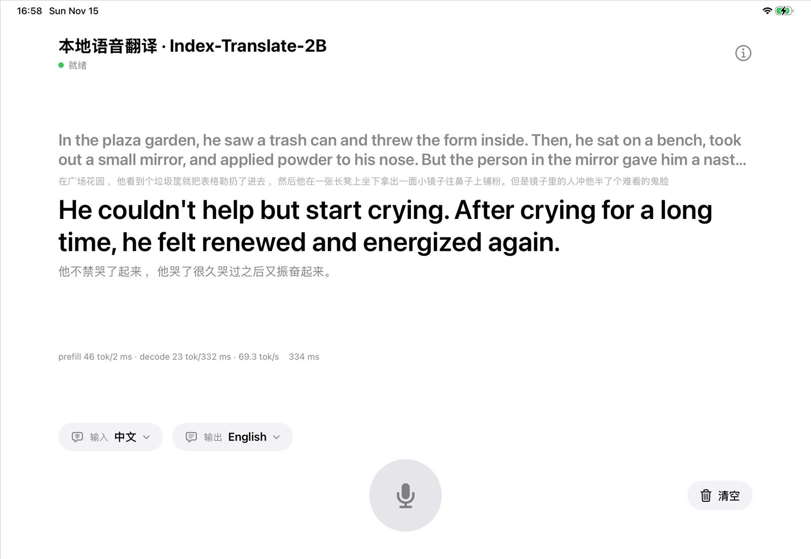
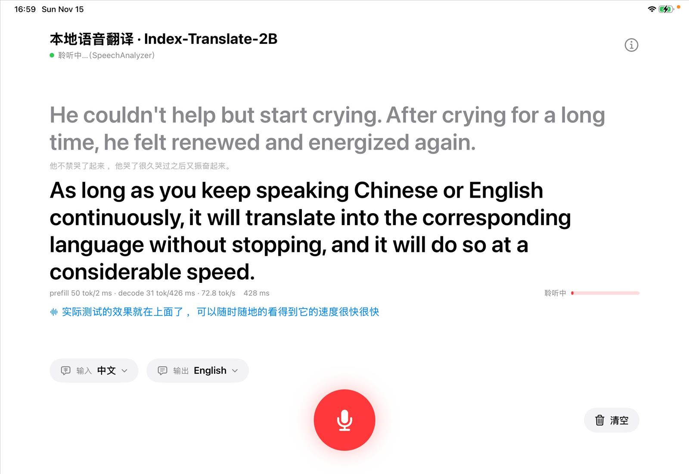
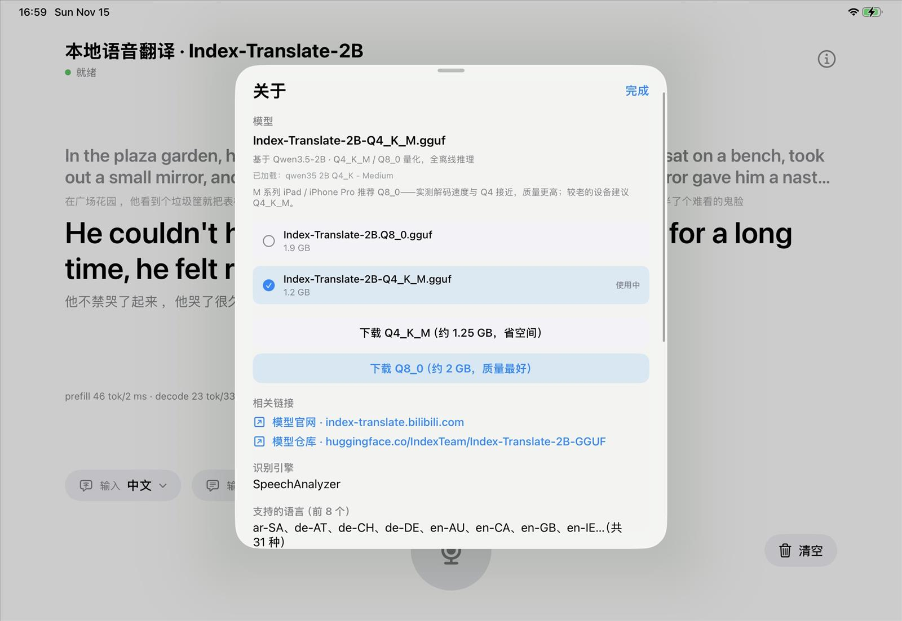
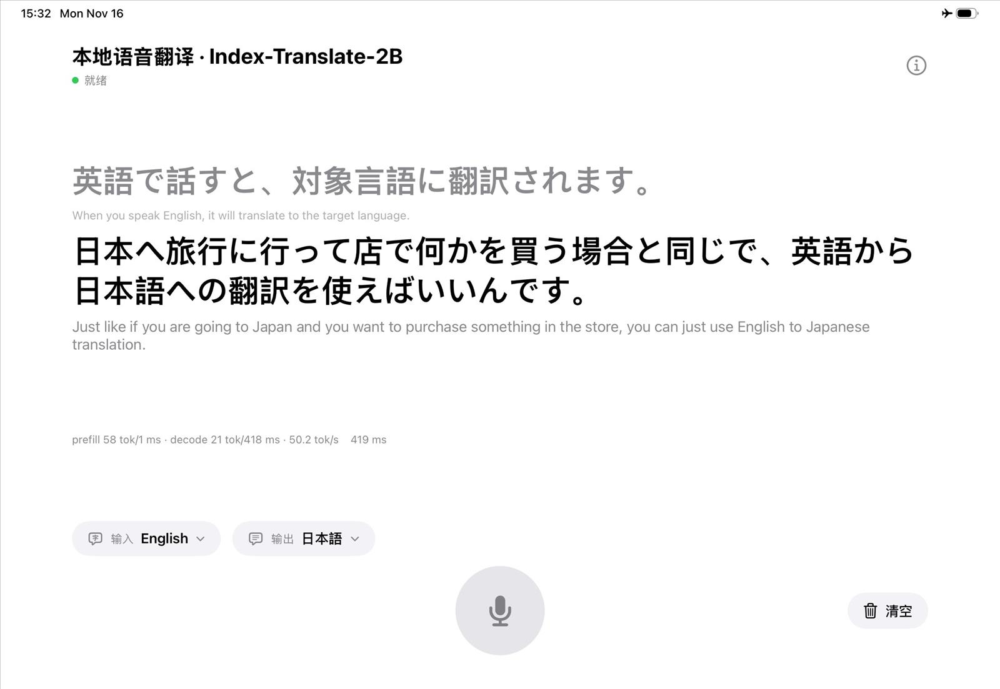
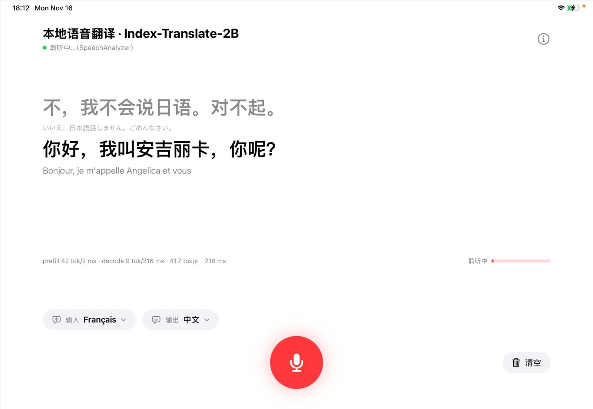

[中文](README.md) | [English](README.en.md)

# index-translate

**在 iPad 上离线运行的语音翻译 App：说完一句话，屏幕上直接出现译文。**


  

## 这是什么

一个 **iPadOS 26** 上的本地语音翻译 App。麦克风 → Apple `SpeechAnalyzer`（设备端流式转写）→ `Index-Translate-2B`（GGUF，llama.cpp + Metal 推理）→ 译文。

音频和文字都只在本机流转，不上传任何服务器。整个 App 不依赖云端、不需要 Mac 开发环境：构建在 GitHub Actions，装机在 Windows 上用 Sideloadly。

模型是 [IndexTeam / bilibili 的 Index-Translate-2B](https://huggingface.co/IndexTeam/Index-Translate-2B)（Apache-2.0）。**本仓库不分发模型权重**，App 只在你点击下载时联网拉取官方 GGUF，或读取你自己放进设备的 `.gguf` 文件。

## 特性

| | 特性 | 说明 |
|---|---|---|
| 🎙 | 设备端流式转写 | `SpeechAnalyzer` + `SpeechTranscriber`（iPadOS 26）；系统自带 31 个语言区的识别资源，App 按你选的输入语言启用对应的识别器 |
| 🌐 | 输入 8 种语言 / 自动 | 中文、English、日本語、한국어、Français、Deutsch、Español、Italiano，外加「自动」（zh-CN + en-US 两路，按转写文字判定；默认只听中文，双识别器是 ⓘ 里的实验开关） |
| 🗣 | 输出 9 种语言 | 中文、英语、日语、韩语、法语、德语、西班牙语、意大利语、**俄语**（俄语目前只做输出：系统识别器还没有俄语模型） |
| 🎯 | 翻译需求 | ⓘ 里选场景（严肃会议 / 朋友小聚 / 初见新朋友 / 旅行中求助 / 陌生人随便聊聊）或自己写要求，按官方 instTrans 格式加一条【注意】约束；默认退出即清空，可勾选「保存这次的需求，下次默认使用」 |
| 📝 | 英文词原样保留 | 中文夹英文时用身份术语表硬约束，`dining hall` / `deadline` / `API` 不会被改写 |
| 📜 | 连续字幕 | 上一句（灰）+ 当前句（黑），另有一行「正在听」实时显示还没定稿的内容 |
| 📊 | 麦克风电平表 | 对数刻度 + 峰值自校准，说话时会跳 |
| 🔇 | 纯标点句自动跳过 | ASR 只吐出「。」「…」这种片段时不浪费一次推理 |
| 📦 | 多模型并存 | Q4_K_M / Q8_0 可以同时放在设备里，ⓘ 面板里切换；没选过时默认用体积最大的 |
| ⚡ | Metal 全量 offload | 26/26 层在 GPU 上，prefill 44,000–48,000 tok/s（iPad Pro M5 实测） |
| 🔒 | 全离线 | 只有首次下载模型需要网络；日常使用完全断网也能跑 |
| 🧾 | 复制诊断 | 一句话把设备型号、引擎、模型、最近耗时、日志尾部复制出来，便于反馈问题 |

## 截图

| 翻译中 | 聆听中 | ⓘ 面板（模型 / 引擎 / 链接） |
|---|---|---|
|  |  |  |

输入语言现在有 8 种，下面两张是上一版新增语言的实拍（iPad Pro M5，本地模型，无网络）：

| 输入 English → 输出 日本語 | 输入 Français → 输出 中文 |
|---|---|
|  |  |

## 快速开始

> 目标是"没有 Mac、只有 Windows 电脑 + 一台 iPad"也能装好。完整版（含排障）见 **[docs/INSTALL-IPAD.md](docs/INSTALL-IPAD.md)**。

1. **拿到 ipa**：从 [Releases](https://github.com/Baizhi-Angelica/IndexTranslate_iPadM5/releases) 下载最新的 `index-translate-v1.2.0-unsigned.ipa`。这是**未签名**包，下一步用你的 Apple ID 重签。
2. **装进 iPad**：先从 **Apple 官网**装 [iTunes（Windows）](https://www.apple.com/itunes/download/win64) 或 [iCloud for Windows](https://support.apple.com/zh-cn/downloads)（两者都会装 Apple 设备驱动），再从 <https://sideloadly.io/> 装 Sideloadly；连上 iPad → 填 Apple ID → 拖入 ipa → Start。首次需要在 iPad 的「设置 → 隐私与安全性 → 开发者模式」里打开开发者模式并重启。
3. **放模型**：二选一——① 打开 App，在模型卡片里点「下载 Q4_K_M / Q8_0」（**优先 ModelScope 国内直连**，失败自动换 `hf-mirror.com` → `huggingface.co`）；② **手动下载**：Safari 打开 [ModelScope 模型页](https://www.modelscope.cn/models/IndexTeam/Index-Translate-2B-GGUF) → 点 `Index-Translate-2B.Q4_K_M.gguf` 或 `Q8_0` → 在「文件」App 里把它拖进 **我的 iPad → index-translate**，回到 App 会自动发现。
4. **授权并说话**：允许麦克风 → 选输入语言和输出语言 → 点大圆麦克风按钮 → 说一句中文或英文，定稿后自动翻译。

> 免费 Apple ID 签名的 App **7 天后失效**，到期用 Sideloadly 点一次 Start 重签即可，模型和设置都保留。

## 模型怎么选

| 档位 | 文件 | 体积 | iPad Pro M5 单句翻译 | 建议 |
|---|---|---:|---:|---|
| **Q4_K_M** | `Index-Translate-2B.Q4_K_M.gguf` | 1,251.4 MB | 166–430 ms | 省空间；较老设备 / iPhone 建议这档 |
| **Q8_0** | `Index-Translate-2B.Q8_0.gguf` | 1,980.5 MB | 与 Q4 接近（实测几乎相同） | **M 系列 iPad 推荐**，质量更高 |

下载源（App 内按这个顺序自动回退，也可以手动下载）：

| 源 | 说明 | 手动下载地址 |
|---|---|---|
| **ModelScope**（首选） | 国内 CDN 直连，无需代理 | [模型页](https://www.modelscope.cn/models/IndexTeam/Index-Translate-2B-GGUF) · Q4_K_M 直链 `https://www.modelscope.cn/models/IndexTeam/Index-Translate-2B-GGUF/resolve/master/Index-Translate-2B.Q4_K_M.gguf` |
| hf-mirror | 国内镜像，ModelScope 不通时回退 | `https://hf-mirror.com/IndexTeam/Index-Translate-2B-GGUF/resolve/main/Index-Translate-2B.Q4_K_M.gguf` |
| HuggingFace | 官方源，需要能访问 | `https://huggingface.co/IndexTeam/Index-Translate-2B-GGUF/resolve/main/Index-Translate-2B.Q4_K_M.gguf` |

> 手动下载的文件放进 **文件 App → 我的 iPad → index-translate** 即可，App 重启后会自己发现；文件名不必改。
> ModelScope 上的文件与 HuggingFace 官方完全一致（LFS 哈希 `044b313d…`，1,312,164,352 字节）。

放置目录：**文件 App → 我的 iPad → index-translate**，把 `.gguf` 拷进去即可（可同时放多个）。

切换方法：点右上角 ⓘ → 「模型」区里选择已加载的模型，或用「下载 Q4_K_M / Q8_0」按钮补一个。没手动选过时，App 默认用**体积最大**的那个。

## 使用说明

- **输入**：中文 / English / 日本語 / 한국어 / Français / Deutsch / Español / Italiano / 自动。自动模式默认只启用中文识别器（英文词仍能被中文识别器捕捉）；想要中英两路同时识别，在 ⓘ 里打开「自动模式双识别器（实验）」，改动在下次开始聆听时生效。首次用某个语言时系统会下载该语言的识别资源（几十 MB，联网一次）。
- **输出**：中文、英语、日语、韩语、法语、德语、西班牙语、意大利语、俄语。若输出语言与输入语言相同，会自动切到对应的另一方（中文↔英文，其它源语言默认翻中文）。
- **翻译需求**：点 ⓘ →「翻译需求」，选一个场景（严肃会议 / 朋友小聚 / 初见新朋友 / 旅行中求助 / 陌生人随便聊聊）或者自己写一句。它会按官方 instTrans 格式作为【注意】约束加进每句提示词；中文→非英语时，身份术语表仍是最前面的【硬性要求】。默认**退出 App 即清空**；想下次还用，勾选底部的「保存这次的需求，下次默认使用」。
- **字幕**：上方大字是当前句译文，中间灰色是上一句译文（同字号、变灰），底部另有「正在听」行显示还没定稿的识别结果；听不懂时那一行会一直变。
- **电平表**：聆听时按钮外圈会随说话音量跳动，用来确认麦克风真的在工作。
- **清空**：底部「清空」按钮清掉当前与上一句；ⓘ 面板里也有同样的入口。
- **诊断**：ⓘ 面板底部「复制诊断」会把设备、引擎、模型、最近一次耗时和日志尾部复制到剪贴板，反馈问题时贴出来即可。
- **纯标点句**：ASR 偶尔只定稿一个「。」或「…」，这类片段会被直接丢弃，不会去请求模型。

## 性能

iPad Pro M5 / iPadOS 26 / Q4_K_M（1,251.4 MB）× 26 层全部 Metal offload，数据来自真机 `Documents/llama.log` 与 App 内显示的耗时：

| 指标 | 实测值 | 说明 |
|---|---|---|
| prefill | **44,000–48,000 tok/s** | prompt 约 90–110 token，通常 2–3 ms |
| decode | **40–73 tok/s** | 短句含首 token 开销；译文 20–30 token 时约 70 tok/s |
| 单句翻译（prefill + decode） | **166–430 ms** | 真正感知到的延迟主要由 ASR 定稿速度决定 |
| Metal 内核首次编译 | **约 173 s（一次性）** | llama.cpp 运行时特化管线；之后冷启动约 0.3 s |
| Q8_0 vs Q4_K_M | 延迟几乎相同 | 同为 M 系列 GPU offload，Q8 只是权重大一些 |

细节与逐次记录见 [docs/REALMACHINE-NOTES.md](docs/REALMACHINE-NOTES.md)；"英文词保留"策略的对照实验（Windows CPU 上的 240 次调用）见 [tools/README.md](tools/README.md)。

## 从源码构建

不需要在本地装 Xcode 也能出包，默认走 GitHub Actions：

- 推送到 `main`，或手动触发 `.github/workflows/build-ipa.yml`（`gh workflow run build-ipa.yml`）。
- runner 是 `macos-26`；流程为：下载 `llama.xcframework`（llama.cpp `b12397` 预编译版，含 Metal）→ `xcodegen generate` → `xcodebuild -configuration Release -destination 'generic/platform=iOS' CODE_SIGNING_ALLOWED=NO` → 打包成未签名 ipa → 发布到 Releases（`build-N`）。
- 工程描述在 [project.yml](project.yml)（XcodeGen），没有手写的 `.xcodeproj`。

有 macOS 想本地构建：

```bash
brew install xcodegen
# 先把 llama.xcframework 放到 Frameworks/，头文件解压到 Sources/MT/include/
xcodegen generate
xcodebuild -project ITXTranslate.xcodeproj -scheme ITXTranslate \
  -configuration Release -destination 'generic/platform=iOS' \
  CODE_SIGNING_ALLOWED=NO build
# 产物在 build/Build/Products/Release-iphoneos/ITXTranslate.app，自行放进 Payload/ 打成 ipa
```

> `llama.framework` 是**动态库**，必须出现在 `ITXTranslate.app/Frameworks/` 里，否则启动即 dyld 崩溃。CI 里对此有校验（ipa 小于 3 MB 直接失败）。

## 已知限制

- **需要 iPadOS 26 及以上**：`SpeechAnalyzer` 是 iOS 26 的新框架。硬件/资源不支持时会自动降级到 `SFSpeechRecognizer`（设备端），此时功能受限、延迟更高。
- **不是逐字流式**：按「一句话定稿再翻译」工作，说话过程中不会边出译文；感受上的延迟主要来自 ASR 什么时候判定这句说完。
- **长句会被 ASR 分段**：一口气说很长时，可能被切成多条分别翻译。
- **单会话上下文不跨句**：每句独立翻译（每句清 KV），不参考上一句的语境；同一句里的代词可能缺上下文。
- **免费 Apple ID 7 天重签**：到期重签一次，模型与设置保留。
- 自动模式的「双识别器」是实验功能，开启后资源占用更高。
- **俄语只能作为输出**：iPadOS 26 的 `SpeechTranscriber` 支持 31 个语言区，里面有意大利语但没有俄语，所以还不能「说俄语 → 翻成中文」。等 Apple 提供俄语识别模型后只要加一行 locale 就能补上。
- **翻译需求是软约束**：模型会尽量遵守语气要求，但不是硬保证；同一套场景文案已经过提示词回归，不改变默认路径的任何行为。

## 常见问题

**装了打不开，提示「未受信任的开发者」**

设置 → 通用 → VPN 与设备管理 → 你的 Apple ID → 信任。然后再打开 App。

**用了 7 天后点开就闪退**

免费 Apple ID 的签名过期了。重新打开 Sideloadly 点一次 Start 重签即可；模型文件在 App 沙盒里，覆盖安装不会丢。

**打开后一直显示「未找到本地模型」**

`.gguf` 要放进 App 自己的目录：**文件 App → 我的 iPad → index-translate**（也可以点 App 里的「从文件导入…」）。放好后回 App 点「重新扫描」，或点 ⓘ 里的下载按钮。文件名不必精确匹配，App 会列出所有 `.gguf` 并默认用体积最大的。

**设置 → 隐私与安全性里没有本 App 的「语音识别」权限项**

正常。`SpeechAnalyzer` 不需要那个权限（它属于旧 `SFSpeechRecognizer` 的流程），只需要麦克风。只有降级到老识别器时才会申请。

**Q8_0 会不会更慢？**

在 M 系列设备上实测几乎一样（见上面「性能」）。体积换质量，值得。老设备再退回 Q4_K_M。

**第一次打开要等很久（几十秒到几分钟）**

模型加载阶段会现场特化 36 个 Metal 内核，首次合计约 173 秒，这是 llama.cpp 的一次性开销；管线缓存写入后，之后冷启动约 0.3 s。

**说了话没反应**

看两处：① 按钮外圈电平表有没有跳（没跳就是麦克风权限或输入设备问题）；② 「正在听」行有没有出现文字（有文字但没译文，说明这句还没定稿）。实在不行点 ⓘ →「复制诊断」把信息贴出来。

**能完全离线用吗？**

可以。日常使用不联网。需要网络的只有两件事：下载模型文件，以及首次使用某个语种时系统下载该语种的识别资源（系统级，几十 MB）。

**「翻译需求」会一直保留吗？**

不会。默认它只在本次打开 App 期间生效，退出就清空；在二级页面勾选「保存这次的需求，下次默认使用」才会写入本机，下次启动自动沿用，取消勾选即恢复「退出清空」。

## 许可证

本仓库的**应用源码**采用 [MIT License](LICENSE)。

模型权重**不在本仓库内，也不随本仓库分发**：[Index-Translate-2B](https://huggingface.co/IndexTeam/Index-Translate-2B) 及其 [GGUF 量化](https://huggingface.co/IndexTeam/Index-Translate-2B-GGUF) 由 IndexTeam / bilibili 以 **Apache License 2.0** 发布，请遵循其许可。App 只在你点击下载时联网获取官方文件，或读取你自己放进设备的模型。

其他第三方：llama.cpp（MIT）、Apple 框架（Apple SDK 条款）。App 图标的第三方插画仅限个人侧载自用，不在 MIT 授权范围内——详见 [LICENSE](LICENSE) 的 Third-party notices。

## 致谢与相关链接

- Index-Translate 在线体验：<https://index-translate.bilibili.com/>
- 官方推理脚本（本项目「翻译需求」的 prompt 格式参考）：[bilibili/Index-Translate · inference/llm/call_api.py](https://github.com/bilibili/Index-Translate/blob/main/inference/llm/call_api.py)
- 模型（Apache-2.0）：[IndexTeam/Index-Translate-2B](https://huggingface.co/IndexTeam/Index-Translate-2B) · [GGUF 量化](https://huggingface.co/IndexTeam/Index-Translate-2B-GGUF)
- 推理运行时：[ggml-org/llama.cpp](https://github.com/ggml-org/llama.cpp)
- Apple 语音框架：[SpeechAnalyzer](https://developer.apple.com/documentation/speech/speechanalyzer)
- 上一代 Android 版（小米 15 + Termux）：[IndexTranslate_OnXiaomi](https://github.com/Baizhi-Angelica/IndexTranslate_OnXiaomi)
- 项目内部文档：[架构与决策](docs/PLAN.md) · [踩坑记录](docs/PITFALLS.md) · [真机验收](docs/REALMACHINE-NOTES.md) · [提示词回归](tools/README.md) · [给 agent 的约束](AGENTS.md)
